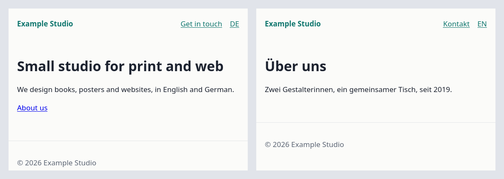

# bilingual-static-site

A static site generator for websites in two languages, in one Python file without dependencies. It takes care of
the parts that are easy to get wrong:

- **Language pairs** with `hreflang` and `canonical` on every page, and a language switch that goes to the same page
  in the other language;
- **a sitemap with language alternates** (`xhtml:link`), the format search engines use for translated pages;
- **hashed asset URLs**: `{{asset:style.css}}` becomes `/assets/style.css?v=49a48659b8`, so assets can be cached for
  a year and a changed file still reaches every visitor;
- **a build that stops** on unknown placeholders, missing assets, duplicate paths and pairs that do not point back,
  before anything is written.



## Quick start

```sh
pip install git+https://github.com/ulliiiiiiiii/bilingual-static-site
bilingual-site build example/            # writes example/dist/
python3 -m http.server -d example/dist   # look at it on http://localhost:8000/
```

Python 3.11 or newer. The output is plain HTML, so any static host works: Cloudflare Pages, Netlify, GitHub Pages,
nginx.

## A site

```text
site.toml            base_url, name, the two languages, values for the templates
base.html            the frame of every page
partials/*.html      pieces for {{include:name}}
pages/en/*.html      pages, one HTML fragment each
pages/de/*.html
assets/              stylesheets, scripts, images, fonts: copied to /assets/
static/              copied as they are into the root: _headers, favicon.ico, ...
```

A page starts with a header comment:

```html
<!--
title: About us
description: Two designers, one shared desk, since 2019.
path: /about/
alternate: /de/ueber-uns/
-->
<h1>About us</h1>
```

| Header | Meaning |
|---|---|
| `title` | required; escaped and available as `{{title}}` |
| `path` | required; the address, ending in `/` (written as `index.html` there) or `.html` |
| `alternate` | the same page in the other language; that page has to name this one back |
| `description` | for `<meta name="description">` and link previews |
| `noindex: yes` | `<meta name="robots" content="noindex">` and not in the sitemap (404 pages, drafts) |
| `draft: yes` | builds, with a warning, and stays out of the sitemap; `--strict` stops the build instead (for the deploy step) |

## Placeholders

| Placeholder | Value |
|---|---|
| `{{name}}`, `{{email}}`, ... | top-level keys of `site.toml`, inserted as written (HTML allowed) |
| `{{lang_<key>}}` | keys of the page's language, e.g. `{{lang_skip}}` for "Skip to content" or "Zum Inhalt" |
| `{{lang}}`, `{{other_lang}}`, `{{other_label}}`, `{{other_url}}`, `{{home}}` | the language switch |
| `{{title}}`, `{{description}}`, `{{canonical}}`, `{{alternates}}`, `{{robots}}`, `{{body}}` | the page |
| `{{include:footer}}` | `partials/footer.html`, with placeholders filled |
| `{{asset:style.css}}` | `/assets/style.css?v=<first 10 hex digits of its SHA-256>` |

An unknown placeholder stops the build with the file name, so a typo never reaches the live site as `{{titel}}`.
Includes and assets cannot reach outside `partials/` and `assets/`, page paths cannot leave the output folder,
and the output folder is only replaced if this tool made it (it holds a `.bilingual-site` marker) or it is empty.

## Caching

With hashed asset URLs, `static/_headers` (read by Cloudflare Pages and Netlify) can cache assets for a year:

```text
/assets/*
  Cache-Control: public, max-age=31536000, immutable
```

Without the hash, phones keep last week's stylesheet next to this week's HTML. With it, a changed file has a new
URL and is fetched at once.

## Tried with

The example site: built with `--strict` (5 pages, 4 of them in the sitemap), served over HTTP, every internal link
followed, all sitemap entries reachable. The tests also change an asset and check that its URL changes.

## Development

```sh
pip install -e ".[dev]"
pytest
ruff check .
```

## License

MIT
